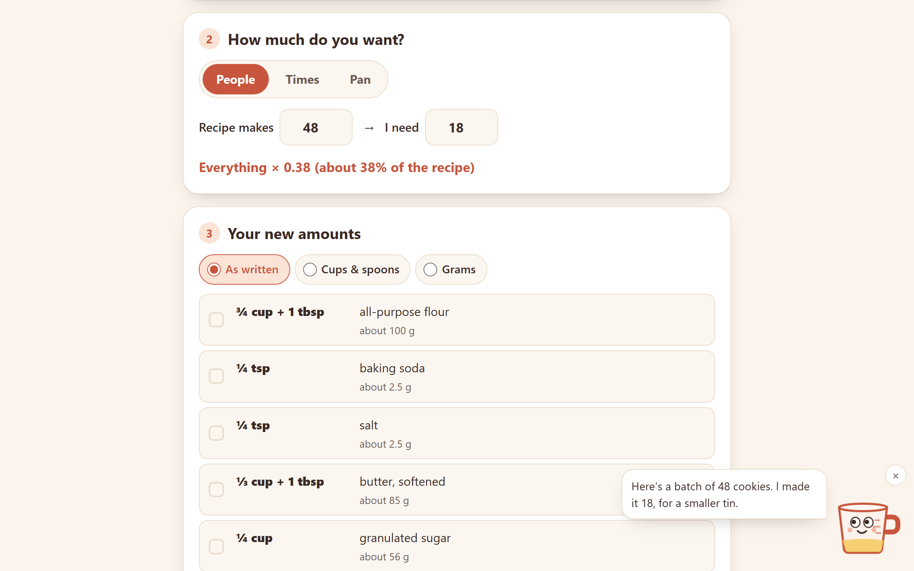

# Batchwise

Make any recipe bigger, smaller or fit the pan you have. Paste the ingredients, say how many it should feed (or which pan you are using), and Batchwise writes back amounts you can actually measure: cups and spoons, or grams. Scoop the measuring cup helps along the way.

**Live:** https://batchwise.johanthegoat.xyz



## The problem

Scaling a recipe sounds like multiplying by a number. In a kitchen it goes wrong in a few known ways:

- **The maths gives amounts nobody can measure.** 2¼ cups × 1.5 is 3.375 cups, and 2 cups × 1.83 is 3.66 cups ([Bakery and Business Math, Open Washington](https://openwa.pressbooks.pub/bakeryandbusinessmath/chapter/pan-size-adjustments/)). Your drawer has ¼, ⅓, ½ and 1 cup measures.
- **A cup is not a weight.** A cup of flour is 120 g and a cup of sugar 198 g ([King Arthur Baking weight chart](https://www.kingarthurbaking.com/learn/ingredient-weight-chart)), so converting to grams needs a number per ingredient. Most American homes don't keep a scale ([Culinary Institute of America](https://ciafoodies.com/?p=150053)), and most of the rest of the world bakes by weight.
- **Cups are different sizes in different countries.** A US cup is 236.6 ml; the UK, Canada, New Zealand and Australia use 250 ml, and an Australian tablespoon is 20 ml, four teaspoons instead of three.
- **A different pan needs a different amount.** An 8 inch round recipe in a 9 inch round needs about 1.27 times everything, and a 9 inch round into a 13 × 9 tray about 1.8 times ([America's Test Kitchen](https://www.americastestkitchen.com/articles/8002-cake-pan-sizes)).
- **Eggs don't divide.** A third of a 2 egg recipe is two thirds of an egg.
- **The oven doesn't match the recipe.** A fan (convection) oven runs hotter for the same dial, so a recipe written for a conventional oven should be set about 20°C (25°F) lower, or kept the same with the time cut by roughly a quarter ([Hoover](https://service.hoover.co.uk/advice-centre/the-oven-is-burning-the-food/151-use-lower-temperatures-when-cooking-with-fan-ovens/), [AO oven guide](https://ao.com/help-and-advice/guides-and-advice/buying-guides/ovens/temperature-guide)). On top of that the heat may be in °C, °F or a gas mark.

## How it works

1. **Paste the ingredients**, one per line, as the recipe writes them: `2 1/4 cups flour`, `1½ tsp salt`, `200g caster sugar`, `2-3 tbsp milk`, `1 (14 oz) can tomatoes`, `1 stick butter`, `2 large eggs`. Pick where the cups and spoons are from.
2. **Pick the size**: people (makes 4, I need 6), times (½, ⅓, 1½×, 2×, 3× or any number), pan (the recipe's pan and yours, from common sizes in inches and cm, or any round, square or rectangle), or **I have**: pick an ingredient, say how much is in the cupboard (300 g of flour when the recipe wants 2 cups), and the whole recipe scales to fit it. It matches on weight, volume or a plain count, converting between weight and volume when the ingredient's density is known, so grams on hand work against a recipe written in cups.
3. **Get the new amounts**, as written, in cups and spoons, or in grams. Tap a line to tick it off as it goes in the bowl. Copy the list, copy a share link, or print it.

There is also an **oven temperature** card: put in the heat a recipe gives, say whether it is °C, °F or a gas mark and which oven it was written for, and read it back for both a normal oven and a fan oven, with a note on trading heat for time.

### The engine

`src/engine.js` has no DOM, so the page and the tests run the same code.

- **Reading lines.** Whole numbers, decimals (with a comma too), fractions, mixed numbers, fraction characters (½ ⅓ ¾) and ranges. Units cover US and metric volume, weight and countable things (cloves, cans, sticks, pinches). A bare `T` is a tablespoon and `t` a teaspoon, as old recipe cards write them. A bracket that restates the amount (`1 cup (2 sticks) butter`) is dropped once scaled, while a can size (`1 (14 oz) can`) is kept.
- **Writing volumes.** Everything is held in ml, then written back with the measures you own: teaspoons down to ⅛, tablespoons plus a teaspoon remainder, and cup fractions (¼ ⅓ ½ ⅔ ¾) with any leftover as whole tablespoons, so 3.375 cups reads "3⅓ cups + 1 tbsp". A cup fraction is used as-is when it lands within half a tablespoon.
- **Grams.** Grams per cup for about 40 common baking ingredients from King Arthur Baking's weight chart, now including almond flour and meal, cornmeal, semolina, cream cheese, molasses, dates, shredded coconut and applesauce. An ingredient not on the list stays in ml rather than taking a guess, and so does kosher salt, which differs by brand by nearly double. Recipes in grams can go the other way, into cups, for the ingredients it knows.
- **Pans.** The factor is the ratio of floor areas (πr² for round, side × side, length × width), which keeps the batter the same depth.
- **Eggs.** A large egg is about 50 g and 3 tablespoons beaten: 1 of yolk, 2 of white ([American Egg Board chart](https://whatscookingamerica.net/eggs/eggequivalent.htm)). Part of an egg comes out as "beat 1 egg and use 2 tbsp (33 g) of it".

Share links carry the recipe and the size in the URL fragment (`#...`), which the browser never sends to a server. The last recipe and its ticks are kept in `localStorage`.

### Scoop

Scoop is an inline SVG measuring cup in the corner. Scoop's eyes follow your pointer (or the field you are typing in), the yellow inside rises or falls with the size you pick, a tap gives a tip for the step you are on, and Scoop reacts to what you do: a new recipe, a very big or tiny batch, part of an egg, switching to grams, the last line ticked off (sprinkles). Tap five times quickly and Scoop tips over. Scoop can be tucked away and holds still if your device asks for reduced motion. Everything Scoop says goes through a live region, so screen readers hear it too.

## Run it

Open `index.html` in a browser, or serve the folder:

```bash
python -m http.server 8000
```

## Test

```bash
npm test
```

Runs on Node 20, 22 and 24 in CI.

## License

MIT
